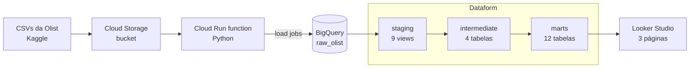

# Olist | Engenharia de Analytics no GCP

Pipeline de dados de ponta a ponta, construído com ferramentas do Google Cloud, que transforma os arquivos brutos de um marketplace brasileiro em tabelas confiáveis para análise de vendas, clientes e operação.

Dashboard: https://datastudio.google.com/s/i4-UmHA-Y6Q

## Objetivo

O dataset público da Olist (cerca de 100 mil pedidos reais e anonimizados, de 2016 a 2018) tem armadilhas que invalidam as métricas de quem o usa sem tratamento. O projeto resolve essas armadilhas de forma organizada, testada e reprodutível, e entrega as respostas em um dashboard.

## Arquitetura



| Camada | Dataset | Função |
|---|---|---|
| Raw | `raw_olist` | Cópia fiel da origem, tudo como texto |
| Staging | `staging` | Renomear, converter tipos e padronizar. Não junta tabelas |
| Intermediate | `intermediate` | Corrige problemas de granularidade antes das junções |
| Marts | `marts` | Modelo estrela (`dim_`, `fct_`) e tabelas analíticas (`mart_`) |
| Testes | `dataform_testes` | Resultado das verificações automáticas |

## Stack

- **Google Cloud Storage:** armazenamento dos arquivos de origem
- **Cloud Run functions (Python):** ingestão serverless
- **BigQuery:** data warehouse
- **Dataform:** transformações em SQL, testes e grafo de dependências
- **Looker Studio:** dashboard
- **GitHub:** versionamento

## Ingestão

Uma função em Python, executada com uma conta de serviço de privilégio mínimo, pede ao BigQuery que carregue cada CSV do bucket em uma tabela (*load job*).

- **Tudo entra como texto (STRING).** A camada raw é cópia fiel. Se o BigQuery inferisse tipos, um CEP como `01409` viraria o número 1409.
- **Carga idempotente** (`WRITE_TRUNCATE`): executar uma ou dez vezes produz o mesmo resultado.
- **Quebras de linha dentro de campos** (`allow_quoted_newlines`): necessárias para os comentários das avaliações.

## Tratamentos principais

A regra que guia o projeto: antes de juntar duas tabelas, cada lado precisa ter uma linha por chave de junção. Do contrário, as linhas se multiplicam e os valores saem inflados.

| Problema na origem | Tratamento | Evidência |
|---|---|---|
| Pedido com vários pagamentos (ex.: voucher + cartão) | `int_pagamentos_pedido`: soma por pedido antes de qualquer junção | 2.961 pedidos tinham mais de um pagamento |
| `customer_id` muda a cada pedido | `int_pedidos_clientes`: traz o `customer_unique_id` (pessoa real) | 99.441 pedidos, 96.096 pessoas, 3.345 pedidos de quem já era cliente |
| Cerca de 53 linhas de geolocalização por CEP | `int_geolocalizacao`: uma linha por CEP, com a média das coordenadas | 1.000.163 linhas viraram 19.015 CEPs; a soma das origens reconcilia com a raw |
| Pedido com mais de uma avaliação | `int_avaliacoes_pedido`: mantém a mais recente | 547 pedidos com duplicidade; 98.673 linhas para 98.673 pedidos |

## Modelo de dados (marts)

| Tabela | Uma linha representa | Linhas |
|---|---|---|
| `dim_produtos` | um produto, com categoria traduzida | 32.951 |
| `dim_vendedores` | um vendedor | 3.095 |
| `dim_clientes` | uma pessoa real, com o endereço da compra mais recente | 96.096 |
| `dim_calendario` | um dia (2016 a 2018) | 1.096 |
| `fct_pedidos` | um pedido | 99.441 |
| `fct_itens_pedido` | um item vendido | 112.650 |

Tabelas analíticas: `mart_vendas_mensais`, `mart_coortes_recompra`, `mart_rfm_clientes`, `mart_vendedores`, `mart_metas_realizado` e `mart_entrega_avaliacao`.

### Regra de venda válida

Em vez de apagar pedidos, a coluna `venda_valida` marca quais contam como venda: status diferente de `canceled` e `unavailable` **e** pelo menos um item. Os dados continuam auditáveis.

Resultado: **98.199 pedidos válidos e R$ 13.494.400,74** de faturamento em itens (sem frete). R$ 97.242,96 de itens de pedidos cancelados ou indisponíveis ficaram de fora.

## Qualidade e validações

O Dataform executa **74 ações**: 25 tabelas ou views e 49 testes automáticos (unicidade de chave e campos obrigatórios), todos passando.

Conferências feitas além dos testes:

- Contagem de linhas de cada tabela bate com a origem (nenhuma junção duplicou ou perdeu linhas).
- Integridade referencial: 0 itens sem produto, vendedor ou cliente nas dimensões.
- Valor dos itens idêntico, ao centavo, na raw e nas duas tabelas de fatos (R$ 13.591.643,70, antes do filtro de venda válida).
- A diferença entre valor pago e itens + frete (R$ 165.462,34) foi explicada: R$ 162.591,95 vêm de 775 pedidos com pagamento e sem itens (603 `unavailable`, 164 `canceled`, 8 outros). Nos pedidos com itens, a diferença é de R$ 2.870,39 (0,02%).

## Principais descobertas

- **Quase ninguém recompra:** a retenção é de cerca de 0,5% no mês seguinte à primeira compra.
- **Campeões e Recorrentes** são cerca de 3% da base e geram aproximadamente 5,6% do faturamento.
- **O atraso pesa mais que o prazo:** nota média de cerca de 4,3 para entregas no prazo contra 2,3 para atrasadas. Uma entrega de 22 a 30 dias no prazo (3,94) é melhor avaliada que uma de 8 a 14 dias com atraso (3,27). O pior grupo, com mais de 30 dias e atraso, tem nota 1,85.
- **Pico de vendas em novembro de 2017** (Black Friday), com cerca de R$ 1 milhão.
- **Concentração geográfica:** São Paulo concentra, de longe, o maior faturamento por cidade de vendedor.

## Dashboard

Três páginas no Looker Studio:

1. **Vendas:** faturamento, pedidos, ticket médio, faturamento mensal e meta vs. realizado
2. **Clientes:** clientes únicos, segmentos RFM e retenção por mês
3. **Operação:** nota por prazo de entrega e atraso, top 10 vendedores e top 10 cidades

## Decisões e limitações

- **Faturamento** é a soma dos itens, **sem frete**. O frete fica em coluna separada.
- **Setembro de 2018** foi excluído das metas, das coortes e do dashboard (R$ 145 de faturamento), porque o dataset termina nessa época. Por isso o faturamento do dashboard (R$ 13.494.255,74) é R$ 145 menor que o total válido.
- **A meta é simulada** (média dos 3 meses anteriores + 10%), pois a Olist não tem metas reais. Ela penaliza os meses seguintes a picos como a Black Friday. O Dataform não tem *seeds* como o dbt, então a regra fica no SQL.
- **A geolocalização usa média por CEP:** serve para análise regional, não para cálculo de distâncias.
- **RFM:** a "data de hoje" é a última compra do dataset. A frequência usa regra fixa, porque cerca de 97% dos clientes compraram uma única vez.
- **Vendedores:** um pedido com itens de dois vendedores conta nos dois (99.542 pedidos em vez de 98.199).
- **Clientes:** `dim_clientes` tem 96.096 pessoas (todos os pedidos), e o RFM tem 94.983 (só quem tem venda válida). O total de clientes não deve ser obtido somando os meses de `mart_vendas_mensais`, pois quem comprou em mais de um mês seria contado duas vezes.
- **Coortes:** o limite `2018-08` está fixo no código da tabela.
- **Execução manual:** a ingestão e o Dataform são disparados manualmente. O agendamento automático é um próximo passo.
- **Dados anonimizados:** os vendedores aparecem como códigos, sem nome.

## Estrutura do repositório

```
definitions/
  declaracoes.js       declara as tabelas da camada raw
  staging/             9 views
  intermediate/        4 tabelas
  marts/               6 modelos (dim_ e fct_) + 6 tabelas analíticas (mart_)
workflow_settings.yaml configurações do projeto
```

## Fonte dos dados

[Brazilian E-Commerce Public Dataset by Olist](https://www.kaggle.com/datasets/olistbr/brazilian-ecommerce) (Kaggle).
